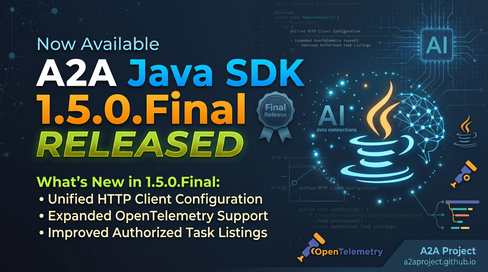

We're happy to announce link:https://github.com/a2aproject/a2a-java/releases/tag/v1.5.0.Final[A2A Java SDK 1.5.0.Final]! This release brings unified HTTP client configuration, a first phase of expanded OpenTelemetry support, and improvements to authorized task listings, alongside fixes across JSON-RPC, REST, and gRPC.

NOTE: This release contains *breaking changes*: custom HTTP client configurations may need adjustment, JPA task stores require a schema migration, and custom server integrations must adapt to changes in the validation SPI. Programmatically built handlers also have corrected blocking timeout defaults. See <<_upgrading_from_14x,Upgrading from 1.4.x>> for affected configurations and practical upgrade examples. Ordinary `AgentExecutor` implementations and applications using the reference servers do not need the server SPI adaptations.

== HTTP Client Configuration in One Place

The new `A2AHttpClientConfiguration` brings provider selection, SSE parser settings, and redirect header policies together:

[source,java]
----
A2AHttpClientConfiguration configuration =
    A2AHttpClientConfiguration.builder()
        .excludedProviderNames(List.of("cdi"))
        .sseParserConfig(SSEParserConfig.builder()
            .maxLineLength(64 * 1024)
            .build())
        .build();

A2AHttpClient client = A2AHttpClientFactory.create(configuration);
----

// Escape leading '#' in PR link labels: Roq's AsciiDoc renderer otherwise
// treats the label as an ID and displays the full URL instead of the PR number.
Providers that cannot honor explicitly requested settings are skipped, so custom SSE limits are no longer silently ignored. Existing factory methods remain available and are deprecated in favor of the configuration API (link:https://github.com/a2aproject/a2a-java/pull/1255[\#1255]).

Redirect handling is now configurable for synchronous GET requests as well as POST requests, with a shared policy across the built-in HTTP clients. Agent card discovery automatically enables one-hop GET redirects; JSON-RPC and REST transport configuration expose an opt-in setting for non-streaming POST requests. SSE requests do not follow redirects (link:https://github.com/a2aproject/a2a-java/pull/1257[\#1257]).

== First Phase of Expanded OpenTelemetry Support

This release delivers an initial expansion of OpenTelemetry support. Streaming lifecycle instrumentation adds linked spans for events and termination, helping correlate the initial request with later stream activity. It also adds the client operation duration histogram `gen_ai.client.operation.duration` and the server streaming duration histogram `gen_ai.agent.a2a.streaming.duration` (link:https://github.com/a2aproject/a2a-java/pull/1236[\#1236]).

Push notification delivery gains tracing and W3C trace-context propagation. Delivery spans record the outcome and task ID for correlation; the HTTP client wrapper propagates trace context to outbound webhook requests while preserving custom HTTP client settings (link:https://github.com/a2aproject/a2a-java/pull/1229[\#1229]).

With the client instrumentation module present, enable client metrics by passing both a `Tracer` under `OpenTelemetryClientTransportWrapper.OTEL_TRACER_KEY` and a `Meter` under `OpenTelemetryClientTransportWrapper.OTEL_METER_KEY` in the transport configuration parameters. The server instrumentation uses a CDI `Meter` bean for its streaming histogram. Without a `Meter`, the corresponding histogram is skipped. See the link:https://a2aproject.github.io/a2a-java/1_5_0_Final/extra/opentelemetry/[versioned OpenTelemetry documentation] for dependencies and configuration examples. These additions are a first phase, and OpenTelemetry support is not yet complete.

== Task Listings That Respect Authorization Before Pagination

Task listings now apply authorization before selecting a page. Page contents, continuation tokens, and totals therefore describe the same set of readable tasks. This improves pagination when authorized and unauthorized tasks are interspersed in storage (link:https://github.com/a2aproject/a2a-java/pull/1258[\#1258]).

For database deployments, the JPA task store can use authorization capabilities to filter count and page queries directly in the database. A new, explicitly selected `JpaTaskAuthorizationProvider` persists task ownership and supplies owner-based read scopes. Existing authorization providers retain a bounded scanning fallback (link:https://github.com/a2aproject/a2a-java/pull/1259[\#1259]).

== Spring Boot Integration Documentation

The server documentation now covers the community link:https://github.com/soheilqalamkari/a2a-spring[a2a-spring integration], which provides Spring MVC JSON-RPC hosting for the SDK (link:https://github.com/a2aproject/a2a-java/pull/1201[\#1201]). See link:https://a2aproject.github.io/a2a-java/1_5_0_Final/server/#server-integrations[Server Integrations] for the available runtime integrations and manual wiring guidance.

== Selected Fixes

This release also addresses several interoperability and reliability issues:

* *JSON-RPC* -- handles omitted parameters and non-object request bodies more reliably (link:https://github.com/a2aproject/a2a-java/pull/1198[\#1198]), and avoids repeated number-parsing exceptions for string request IDs (link:https://github.com/a2aproject/a2a-java/pull/1254[\#1254]).
* *REST* -- correctly formats single-digit history lengths (link:https://github.com/a2aproject/a2a-java/pull/1200[\#1200]) and includes missing query parameters in task and push notification configuration listings (link:https://github.com/a2aproject/a2a-java/pull/1239[\#1239]).
* *gRPC* -- task listing works without a tenant (link:https://github.com/a2aproject/a2a-java/pull/1240[\#1240]).
* *Event queues* -- gracefully closed child queues receive awaited final events (link:https://github.com/a2aproject/a2a-java/pull/1227[\#1227]).
* *JSON serialization* -- explicit nulls are preserved in data and metadata (link:https://github.com/a2aproject/a2a-java/pull/1261[\#1261]).
* *Task listings* -- responses with fewer tasks than the requested page size are accepted (link:https://github.com/a2aproject/a2a-java/pull/1273[\#1273]).
* *Push notification configuration IDs* -- retrieving a configuration with an omitted or empty ID now falls back to the task ID instead of rejecting the request (link:https://github.com/a2aproject/a2a-java/pull/1242[\#1242]).
* *Programmatic handler timeouts* -- builder defaults now match the documented 30/5/1 seconds, replacing 5/2/1 seconds. New setters let manually wired applications override each timeout (link:https://github.com/a2aproject/a2a-java/pull/1249[\#1249]); see <<_programmatically_built_handler_timeouts,Programmatically Built Handler Timeouts>> to preserve the previous values.

The link:https://github.com/a2aproject/a2a-java/compare/v1.4.0.Final...v1.5.0.Final[full changelog] includes all fixes, dependency updates, and testing improvements.

== Upgrading from 1.4.x

Update your SDK BOM to `1.5.0.Final`:

[source,xml]
----
<dependencyManagement>
    <dependencies>
        <dependency>
            <groupId>org.a2aproject.sdk</groupId>
            <artifactId>a2a-java-sdk-bom</artifactId>
            <version>1.5.0.Final</version>
            <type>pom</type>
            <scope>import</scope>
        </dependency>
    </dependencies>
</dependencyManagement>
----

=== Custom JDK HTTP Clients and Redirects

If you wrap your own `java.net.http.HttpClient`, native redirect policies such as `NORMAL` or `ALWAYS` now cause an `IOException` when SDK-managed redirect following is enabled. This also affects agent card discovery, which enables GET redirects automatically.

Build the supplied JDK client with `HttpClient.Redirect.NEVER` and let the SDK handle redirects:

[source,java]
----
import java.net.http.HttpClient;

import org.a2aproject.sdk.client.http.JdkA2AHttpClient;
import org.a2aproject.sdk.client.transport.jsonrpc.JSONRPCTransportConfig;
import org.a2aproject.sdk.client.transport.rest.RestTransportConfig;

HttpClient jdkClient = HttpClient.newBuilder()
    .followRedirects(HttpClient.Redirect.NEVER)
    // Keep your existing TLS, proxy, and timeout settings here.
    .build();

JdkA2AHttpClient httpClient = new JdkA2AHttpClient(jdkClient);

// Enable one-hop redirects for non-streaming POST requests if needed.
JSONRPCTransportConfig jsonrpcConfig =
    new JSONRPCTransportConfig(httpClient, true);
RestTransportConfig restConfig =
    new RestTransportConfig(httpClient, true);
----

Use the configuration for your chosen transport. If you issue HTTP requests directly, call `.followRedirects(true)` on the GET or POST builder instead. The default SDK-created JDK client already disables native redirects.

The shared policy follows at most one hop and filters cross-origin headers. If an endpoint requires a redirect the policy does not follow, configure the final endpoint URL directly; this is also necessary for SSE streaming. See the link:https://a2aproject.github.io/a2a-java/1_5_0_Final/security/[redirect policy documentation] for supported redirects and trusted-origin header configuration.

=== Explicit SSE Settings Must Be Supported

Previously, if no provider supported a requested `SSEParserConfig`, the factory could fall back to a provider that ignored it. It now skips unsupported providers and throws `IllegalStateException` if no eligible provider can create a client.

If this affects your provider setup, use a client that applies the requested limits. For example, select the built-in JDK implementation directly and pass it to your transport:

[source,java]
----
JdkA2AHttpClient httpClient = JdkA2AHttpClient.withSseConfig(
    SSEParserConfig.builder()
        .maxLineLength(64 * 1024)
        .build());

JSONRPCTransportConfig config = new JSONRPCTransportConfig(httpClient);
----

Use `RestTransportConfig(httpClient)` for REST. If you maintain a custom provider, implement `createWithSseConfig(...)` to apply the settings and return `true` from `supportsSseConfig()`. Existing factory entry points such as `create()` and `createWithSseConfig(...)` remain available; moving to `create(A2AHttpClientConfiguration)` is recommended but is not required to keep them compiling.

=== JPA Task Store Schema and Ownership

The updated JPA store cleans up ownership records when deleting tasks, so the ownership table is required even if you keep your existing authorization provider. Before deploying, add the table and index through your database migration tool. For PostgreSQL:

[source,sql]
----
CREATE TABLE a2a_task_owners (
    task_id VARCHAR(255) PRIMARY KEY,
    subject_key BYTEA NOT NULL
);
CREATE INDEX a2a_task_owner_subject
    ON a2a_task_owners (subject_key, task_id);
----

For MySQL 8, use `VARBINARY(1024)` for `subject_key` instead of `BYTEA`. Subject keys must preserve the exact UTF-8 bytes of the authenticated username. Check your existing task table against the link:https://a2aproject.github.io/a2a-java/1_5_0_Final/extra/storage/[storage documentation] as part of the migration.

If your `persistence.xml` lists entities explicitly, register both in the same `a2a-java` persistence unit:

[source,xml]
----
<class>org.a2aproject.sdk.extras.taskstore.database.jpa.JpaTask</class>
<class>org.a2aproject.sdk.extras.taskstore.database.jpa.JpaTaskOwner</class>
----

Quarkus deployments scanning the JPA module's package discover both entities automatically. You can keep your existing `TaskAuthorizationProvider`; the new ownership provider is optional. To select it in Quarkus:

[source,properties]
----
quarkus.arc.selected-alternatives=org.a2aproject.sdk.extras.taskstore.database.jpa.JpaTaskAuthorizationProvider
----

When switching to this provider, backfill ownership for existing tasks from a trusted source before enabling it. Tasks without an ownership record are denied. Use authenticated usernames that uniquely identify users across your deployment, including across tenants or identity providers. The link:https://a2aproject.github.io/a2a-java/1_5_0_Final/extra/storage/[storage documentation] also covers portable CDI and programmatic setup.

Task listings with an existing custom authorization provider may use the bounded scan fallback. If a JPA listing exceeds the default 10,000-candidate limit, narrow the listing filters or increase `a2a.max-scanned-tasks` to a suitable positive value after assessing the scan cost. The new ownership provider supports filtering directly in the database and avoids that fallback limit for its supported policy.

=== Programmatically Built Handler Timeouts

`DefaultRequestHandler.builder()` now defaults to 30 seconds for agent execution, 5 seconds for event consumption, and 1 second for TaskStore reconciliation. Previously, manually built handlers used 5/2/1 seconds, so blocking calls may now wait longer. To retain those previous values, configure the new setters on your handler builder:

[source,java]
----
DefaultRequestHandler.Builder builder = DefaultRequestHandler.builder()
    .agentCompletionTimeoutSeconds(5)
    .consumptionCompletionTimeoutSeconds(2)
    .reconciliationTimeoutSeconds(1);

// Configure your executor, stores, and remaining dependencies before build().
----

The `a2a.blocking.*` configuration properties apply to CDI-managed handlers; manually wired handlers use these builder setters. See link:https://github.com/a2aproject/a2a-java/pull/1249[\#1249] for the correction.

=== Custom Server Integrations (SPI)

Server validation is now centralized. Integrations calling the transport handlers or removed `AgentCardValidator` resolution helpers must adapt. For example, a custom REST route must pass the raw `historyLength` query string to `RestHandler.getTask`, leaving parsing and validation to the handler.

Before (1.4.x):

[source,java]
----
String historyLength = routingContext.request().getParam("historyLength");
restHandler.getTask(context, tenant, taskId,
    historyLength == null ? null : Integer.valueOf(historyLength));
----

After (1.5.0):

[source,java]
----
String historyLength = routingContext.request().getParam("historyLength");
restHandler.getTask(context, tenant, taskId, historyLength);
----

REST push configuration listing similarly accepts a raw `pageSize` string. Card resolution helpers move to `AgentCardResolver`, request preflight to `AgentCardRequestPolicy`, and cached transport validation to `CachingAgentCardTransportValidator`. Follow the updated reference integration in link:https://github.com/a2aproject/a2a-java/pull/1213[\#1213]. Ordinary `AgentExecutor` implementations and applications using the reference servers do not need these SPI adaptations.

== Also Released: 0.3.4

For users on the 0.3.x branch, link:https://github.com/a2aproject/a2a-java/releases/tag/v0.3.4.Final[0.3.4] is also available. It includes Gson serialization, structured SSE parsing, push notification webhook authentication support, and an in-memory queue fix.

Although its GitHub tag is `v0.3.4.Final`, the published Maven version is *`0.3.4`*, under the `io.github.a2asdk` group.

== Contributors

Thank you to everyone who contributed code, tests, documentation, and reports for this release, and welcome to our new contributors!

link:https://github.com/ehsavoie[@ehsavoie], link:https://github.com/kabir[@kabir], link:https://github.com/Zhuoxi2000[@Zhuoxi2000], link:https://github.com/014-code[@014-code], link:https://github.com/Kudwa-Abhishek[@Kudwa-Abhishek], link:https://github.com/misysin[@misysin], link:https://github.com/Emryswu[@Emryswu], link:https://github.com/sumitvairagar[@sumitvairagar], link:https://github.com/soheilqalamkari[@soheilqalamkari], link:https://github.com/jeroenbellen[@jeroenbellen], link:https://github.com/prachisinghal-1[@prachisinghal-1], link:https://github.com/RaphaelFakhri[@RaphaelFakhri], link:https://github.com/SashaMIT[@SashaMIT]

== Resources

* link:https://github.com/a2aproject/a2a-java/releases/tag/v1.5.0.Final[Release Notes on GitHub]
* link:https://central.sonatype.com/artifact/org.a2aproject.sdk/a2a-java-sdk-parent/1.5.0.Final[Maven Central]
* link:https://javadoc.io/doc/org.a2aproject.sdk/[JavaDoc]
* link:https://a2a-protocol.org/v1.0.0/specification/[A2A Specification]
* link:https://a2aproject.github.io/a2a-java/[Project Website]
* link:https://github.com/a2aproject/a2a-java/tree/main/examples[Examples]

== Come Join Us

We value your feedback a lot so please report bugs, ask for improvements etc. Let's build something great together!

If you are an A2A Java SDK user or just curious, don't be shy and join our welcoming community:

* provide feedback on link:https://github.com/a2aproject/a2a-java/issues[GitHub];
* craft some code and link:https://github.com/a2aproject/a2a-java/pulls[push a PR];
* discuss with us in the `#a2a-java` channel on link:https://discord.gg/jTtSkJB74Q[Discord];
